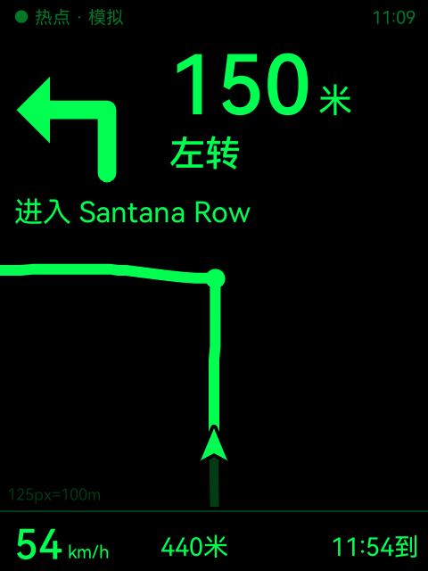
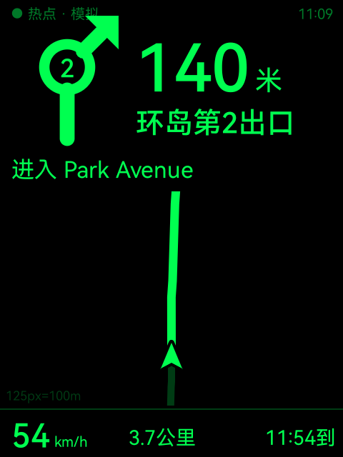
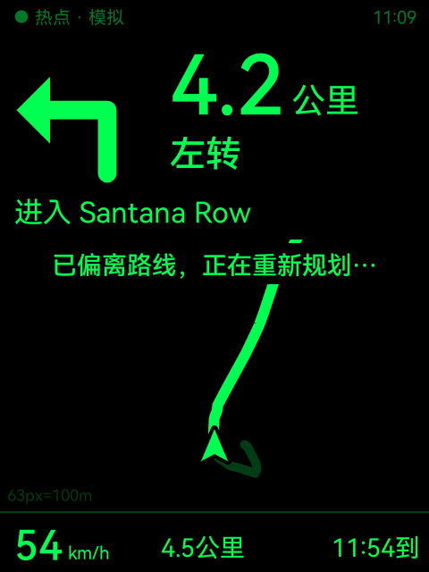

# 骑行导航 HUD（Qixing HUD）

给 **Rokid（乐奇）AR 眼镜** 用的免费骑行导航，主要面向海外用户。手机负责定位、搜索和算路，眼镜上显示类似国内乐奇导航的 HUD 画面：转向箭头、离路口的距离、要进入的道路、车头朝上的小地图、车速、剩余距离和预计到达时间。

**完全免费**：不需要 Google Maps API Key，也不需要注册任何账号。地图数据来自 OpenStreetMap，路线由 OSRM 计算，地点搜索用 Photon / Nominatim。

> Free cycling navigation for Rokid AR glasses. The Android phone does GPS, search and bike routing (OpenStreetMap / OSRM / Photon, no API key) and streams turn-by-turn data to a monochrome HUD app on the glasses over Wi-Fi/hotspot or Bluetooth. The apps speak Chinese and English: they follow the phone's language, and a button in the phone app switches at any time.

| 转弯前 | 环岛 | 偏离路线 |
|:---:|:---:|:---:|
|  |  |  |

**完整的功能介绍和截图见 [docs/功能介绍.md](docs/功能介绍.md)。** · **[English guide](docs/README_EN.md)**

## 功能

- 骑行路线规划（OSRM 自行车路线）。骑错路会自动重新规划。
- 中文语音播报转弯：
  - 默认在**眼镜扬声器**播放，眼镜没连上时改用手机。
  - 两个路口挨得近时，会提前说"随后右转"。
  - 用手机播放时会自动压低音乐。
- 眼镜 HUD：
  - 大转向箭头，环岛会显示第几出口。
  - 离路口的距离，以及要进入的道路名。
  - 车头朝上的路线小地图，轻点触控板可缩放。
  - 车速、剩余距离、预计到达时间。
- 开始导航、接近路口时自动唤醒眼镜屏幕。可选**省电模式**：离路口远时允许熄屏。
- 手机通知栏和锁屏显示下一个转弯。
- **中文 / English**：界面、语音、眼镜画面都支持两种语言，默认跟随系统语言，可随时切换。
- 骑到一半手机端被系统关掉，重新打开点"继续上次导航"即可接着骑。没有网络时用开始导航时保存的路线。
- 往返、绕圈路线（终点在起点附近、路线经过同一路口两次）判断不会错乱。
- 两种连接方式，哪个先连上用哪个：
  - 手机热点或同一 Wi-Fi（TCP，加 UDP 广播自动发现）。
  - 经典蓝牙 RFCOMM。
- "模拟骑行"：在家就能沿整条路线预览一遍。
- 眼镜端内置手机端安装包。手机浏览器打开眼镜屏幕上显示的地址就能下载。

## 硬件 / 系统

- 手机：Android 9+，需要 GPS。在三星 Galaxy A55 上开发。
- 眼镜：Rokid 眼镜（Android 12，480×640 单色绿屏），实测机型为 RV101。其他能装 APK 的安卓眼镜理论上也能用。

## 目录

```
common/   两端共用：协议常量、地理计算
phone/    手机端：定位、搜索、算路、语音、向眼镜推送
glasses/  眼镜端：连接手机、HUD 绘制、自动唤醒
build.ps1 不依赖 Gradle 的构建脚本（aapt2 + javac + d8 + apksigner）
安装包/   使用说明
```

## 构建

需要：
- Android SDK：build-tools 35.0.0、platforms android-36。
- JDK 17。
- Windows PowerShell。

```powershell
# 设置 ANDROID_HOME 和 JAVA_HOME，或者新建 build.local.ps1：
#   $AndroidSdk = "C:\path\to\android-sdk"; $Jdk = "C:\path\to\jdk-17"; $KsPass = "your-password"
.\build.ps1
# 输出：out\qixing-phone.apk、out\qixing-glasses.apk
```

第一次构建会在 `signing/` 下生成本地签名密钥。这个密钥不要提交到仓库。

## 安装

1. 用 adb 把 `qixing-glasses.apk` 装到眼镜上，然后执行一次下面的命令（允许弹出画面、不被省电停掉、可以连蓝牙）：
   ```
   adb install qixing-glasses.apk
   adb shell appops set com.qixing.hud.glasses SYSTEM_ALERT_WINDOW allow
   adb shell dumpsys deviceidle whitelist +com.qixing.hud.glasses
   adb shell pm grant com.qixing.hud.glasses android.permission.BLUETOOTH_CONNECT
   ```
2. 把 `qixing-phone.apk` 装到手机上。可以直接装，也可以用手机浏览器打开眼镜上显示的地址下载。
3. 手机打开「骑行导航」，权限全部允许，并允许"忽略电池优化"。
4. 让眼镜连上手机：
   - 手机开热点，眼镜连上这个热点；或者
   - 打开手机蓝牙（眼镜要和手机配对过）。
   
   手机界面显示"眼镜：已连接"就可以了。
5. 搜索目的地（英文地名最容易搜到，也支持直接输入 `纬度,经度`），点"开始导航"。

## 通信协议

两端之间传 UTF-8 JSON，一行一条消息。

| 通道 | 说明 |
|---|---|
| TCP 47800 | 手机端监听，眼镜端连接 |
| UDP 47801 | 手机端每 2 秒广播 `QXHUD1:`，供眼镜端发现 |
| HTTP 47802 | 眼镜端提供手机端 APK 下载 |
| 蓝牙 RFCOMM | UUID `6b1c2a50-4b6e-4f0e-9d3a-7f1c5e2b8a41` |

消息类型：
- `route`：路线点 `pts` 和转向点 `steps`。
- `state`：大约每秒一条，包含位置、车速、下一个动作、距离、剩余里程、预计到达时间、省电开关 `eco`、语言 `lang`（`zh` / `en`）等。
- `say`：语音片段，16 位单声道 PCM，Base64 编码，`rate` 是采样率。
- `ping`：保活。

## 安全提示

同一个 Wi-Fi 里的设备都能连到手机端的 47800 端口，读取导航数据（包括位置）。建议用手机热点或蓝牙连接眼镜，不要在公共 Wi-Fi 下使用。

## 使用的免费服务

请遵守各服务的使用政策，不要拿来做大批量请求：

- 路线：[routing.openstreetmap.de](https://routing.openstreetmap.de/)（FOSSGIS OSRM），备用 router.project-osrm.org
- 搜索：[Photon](https://photon.komoot.io/)（komoot），备用 [Nominatim](https://nominatim.org/)
- 地图数据 © [OpenStreetMap](https://www.openstreetmap.org/copyright) 贡献者，ODbL 许可

## 免责声明

- 骑车时请以看路为主，眼镜画面和语音提示只是辅助。
- 本项目和 Rokid / 乐奇官方无关。Rokid 是其各自所有者的商标。

## 许可

[MIT](LICENSE)
