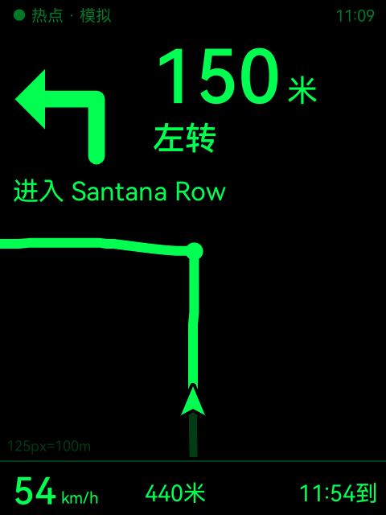
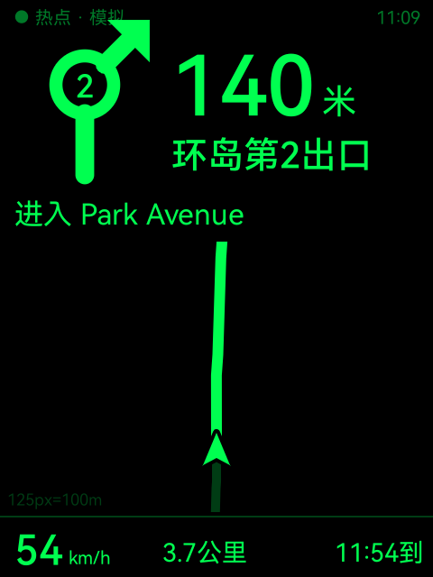
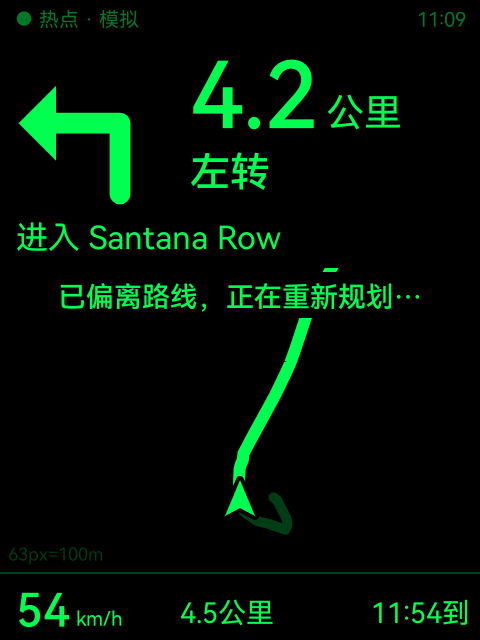

# Bike Nav HUD (Qixing HUD)

Free turn-by-turn cycling navigation for **Rokid AR glasses**. Your Android phone does GPS, search and bike routing; the glasses show a head-up display with the turn arrow, distance to the turn, the next road, a heading-up mini map, speed, remaining distance and ETA.

**It costs nothing.** No Google Maps API key and no account: map data comes from OpenStreetMap, routes from OSRM, place search from Photon / Nominatim.

| Before a turn | Roundabout | Off route |
|:---:|:---:|:---:|
|  |  |  |

(The screenshots show the Chinese display. With English selected, the same screens read "Turn left", "Roundabout exit 2", "Off route. Rerouting…".)

## What it does

- Bicycle routing. A wrong turn is caught in about 5 seconds and the route is recalculated.
- On the glasses your position sits on the route line, the arrow follows the road, and the distance to the turn counts down smoothly (no jumping at red lights).
- Voice prompts allow for GPS and playback delay, so "In 50 meters" really means 50 meters when you hear it.
- Voice prompts in English or Chinese:
  - Played on the glasses' speaker by default, so you hear them with the phone in a pocket.
  - Two turns close together are announced together: "In 50 meters, turn left, then turn right".
- HUD on the glasses that wakes before each turn. An optional power-saving mode lets the screen sleep on long straight stretches.
- Three ways to connect, used at the same time (whichever links first wins, and it reconnects by itself):
  - the phone's hotspot or shared Wi-Fi;
  - Bluetooth LE, **no pairing needed**: it links as soon as Bluetooth is on;
  - classic Bluetooth, when the glasses are paired with the phone.
- After the glasses reboot, the HUD app starts again by itself within about a minute and reconnects.
- Saved places: tap ☆ next to a place to save it, tap ★ to remove it. Saved places stay at the top of the list.
- Next turn on the phone's notification and lock screen.
- "Continue last ride": if Android kills the app mid-ride, one tap resumes to the same destination. Without a network it uses the route saved when the ride started.
- One tap on a place starts the ride and the glasses follow. "Simulation" in Settings previews the whole route on the glasses at home.

## Language

The apps follow the phone's system language (Chinese if the phone is set to Chinese, English otherwise). The button in the top-right corner of the phone app switches at any time, even while navigating; the glasses follow the phone.

English voice uses the phone's own text-to-speech engine. If no English voice is installed, the phone's default voice is used.

## Requirements

- Phone: Android 9 or later, with GPS. Tested on a Samsung Galaxy S24+ (Android 17).
- Glasses: Rokid glasses running Android 12 (developed on the RV101, 480×640 monochrome green). Other Android-based glasses that can install APKs may work but are untested.

## Install

Download both APKs from the [latest release](https://github.com/PYCST-DDZYL/qixing-hud/releases/latest).

1. Install `qixing-glasses.apk` on the glasses with adb, then run these once (lets the HUD pop up, keeps it alive, allows Bluetooth):
   ```
   adb install qixing-glasses.apk
   adb shell appops set com.qixing.hud.glasses SYSTEM_ALERT_WINDOW allow
   adb shell dumpsys deviceidle whitelist +com.qixing.hud.glasses
   adb shell pm grant com.qixing.hud.glasses android.permission.BLUETOOTH_CONNECT
   ```
2. Install `qixing-phone.apk` on the phone. You can also open the address shown on the glasses in the phone's browser and download it from there.
3. Open the phone app, allow every permission it asks for, and allow "ignore battery optimization".
4. Connect the glasses:
   - turn on the phone's hotspot and join it from the glasses; or
   - turn on Bluetooth on the phone (no pairing needed; the two apps find each other).

   The phone app shows "Glasses: connected" when it works.
5. Search for a destination (or type `lat,lon`), and tap a place: the ride starts right away.

On the glasses: tap the touchpad to zoom the mini map; Back sends the HUD to the background without stopping navigation.

## Build

Needs the Android SDK (build-tools 35.0.0, platform android-36), JDK 17 and Windows PowerShell.

```powershell
# Set ANDROID_HOME and JAVA_HOME, or create build.local.ps1 with:
#   $AndroidSdk = "C:\path\to\android-sdk"; $Jdk = "C:\path\to\jdk-17"; $KsPass = "your-password"
.\build.ps1
# Output: out\qixing-phone.apk, out\qixing-glasses.apk
```

The first build creates a local signing key under `signing/`. Do not commit it.

## Known limits

- Not yet verified on a real ride with real GPS (the phone-to-glasses link has been tested on real devices; positions were simulated). Feedback in Issues is welcome.
- The pairing-free Bluetooth link is not encrypted: a nearby device running this app could connect too.
- Planning, search and rerouting need a network on the phone. Positioning during the ride uses GPS only.
- On a shared Wi-Fi, other devices on the same network can connect to the phone app and read navigation data, including your position. Use the phone's hotspot or Bluetooth, not public Wi-Fi.
- Voice volume on the glasses follows the glasses' media volume.

## Free services used

Please respect their usage policies and do not send bulk requests.

- Routing: [routing.openstreetmap.de](https://routing.openstreetmap.de/) (FOSSGIS OSRM), fallback router.project-osrm.org
- Search: [Photon](https://photon.komoot.io/) by komoot, fallback [Nominatim](https://nominatim.org/)
- Map data © [OpenStreetMap](https://www.openstreetmap.org/copyright) contributors, ODbL

## Disclaimer

Keep your eyes on the road; the display and voice are only aids. This project is not affiliated with Rokid. Rokid is a trademark of its owner.

## License

[MIT](../LICENSE)
