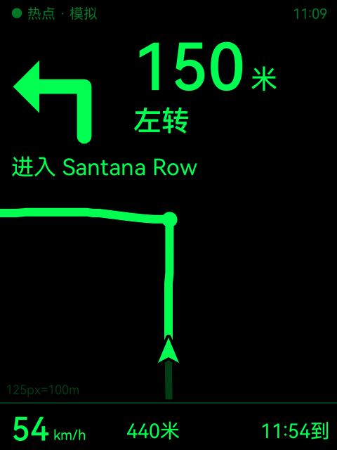
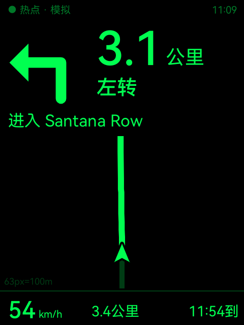
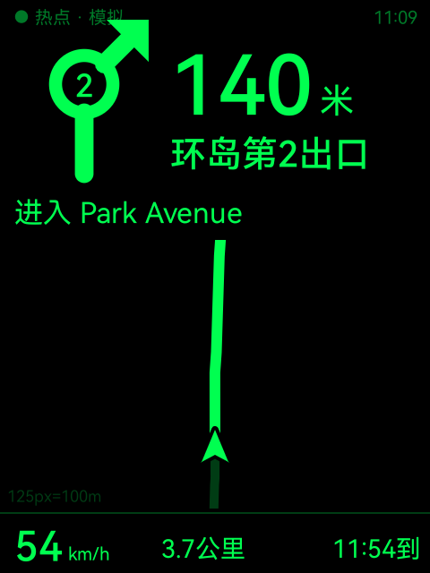

# 骑行导航 HUD 功能介绍

一句话介绍：**戴上乐奇（Rokid）眼镜骑车，眼前就有转向箭头和路线，耳边有中文语音提示，而且完全免费。**

本项目主要为海外用户设计。国内乐奇眼镜有高德导航，海外没有可用的方案，Google 地图又要付费的 API Key。所以这个项目改用 OpenStreetMap 的公益服务，不注册、不用密钥、不收费。

---

## 眼镜上能看到什么

| 转弯前 | 长直路 | 环岛 |
|:---:|:---:|:---:|
|  |  |  |
| 大箭头和距离，下一条路的路名，小地图上实心圆点是下一个路口 | 距离较远时，小地图自动缩小，能看到更远的路 | 显示从第几个出口出去 |

| 偏离路线 | 到达 | 连接上手机 |
|:---:|:---:|:---:|
|  |  |  |
| 骑错路时会提示，并自动重新规划 | 显示终点旗子，约 25 秒后自动结束 | 没有导航时显示车速和时间 |

画面各部分的含义：

- **左上角**：连接方式（热点或蓝牙）。处于模拟中或 GPS 信号弱时，也会显示在这里。
- **大箭头**：下一个动作。支持左转、右转、向左前方、向右前方、急转、掉头、环岛（带出口编号）、到达。
- **大数字**：离下一个路口还有多远。
- **小地图**：
  - 车头朝上，你的位置是三角形箭头。
  - 前方路线是亮线，骑过的路线是暗线。
  - 快到路口时自动放大，路口远时自动缩小。
  - 轻点眼镜触控板，可以手动放大或缩小。
- **底部**：当前车速、剩余距离、预计到达时间。

## 语音提示

- 中文播报，例如：
  - "前方 250 米，左转，进入 Santana Row"
  - "前方 50 米，左转"
- 两个路口挨得很近时，会提前连着说，例如"前方 50 米，左转，随后右转"，不会等来不及了才提醒。
- 骑错路时说"已偏离路线，正在重新规划"，同一次偏离只说一次，不会重复唠叨。
- **语音在眼镜播放**（默认开启）：手机合成语音后传到眼镜，用眼镜扬声器播出。骑车时手机放在口袋里也听得见。眼镜没连上时，自动改用手机播放。
- 用手机播放时，会先压低正在播放的音乐，播完再恢复。

## 手机端

- **搜索目的地**：
  - 输入地名、地址或店名。英文地名最容易搜到，例如 Costco、Santana Row。
  - 也可以直接输入"纬度,经度"。
  - 搜索结果按离你的距离从近到远排列。
- **最近去过的地方**：自动记住最近 10 个，点一下就能重新规划路线。
- **骑行路线**：
  - 优先使用自行车路线。
  - 骑行服务暂时不可用时，依次改用步行路线、驾车路线。改用驾车路线时会醒目提醒，因为可能经过禁止自行车的道路。
- **模拟骑行**：在家就能沿整条路线在眼镜上预览一遍。
- **继续上次导航**：骑到一半手机端被系统关掉时，重新打开会在列表第一行显示"↻ 继续上次导航"，点一下就从当前位置重新规划，接着骑。正常到达或手动结束后，这一行不会出现。
- **往返和绕圈路线**：终点就在起点附近，或者路线经过同一个路口两次时，转弯顺序和"已到达"的判断都不会错乱。
- **通知栏和锁屏**：显示下一个转弯和剩余距离，锁屏也能看到。
- **眼镜省电**（默认关闭）：开启后，离下一个路口超过 400 米时眼镜可以熄屏，接近路口时自动亮屏。适合长途骑行。

## 连接方式

眼镜和手机支持两种连接方式，可以同时开着，哪个先连上就用哪个，断了会自动重连：

1. **手机热点**：手机开个人热点，眼镜连上这个热点。眼镜会自动发现手机。
2. **蓝牙**：眼镜和手机配对过就行，不需要额外设置。

另外，眼镜屏幕上会显示一个网址。手机浏览器打开这个网址，就能下载手机端安装包。

## 稳定性

发布前做过以下测试：

- 在眼镜上用圣何塞的真实路线完整模拟骑行，验证了转向提示、语音、偏航重算、到达和自动结束。
- 用安卓的测试定位注入"真实 GPS"信号骑完整条路线（走的是真实 GPS 的处理流程）。信号带约 3 米随机误差，过程中偏离路线 120 米、GPS 中断 12 秒、手机端被强制关闭后点"继续上次导航"，最后骑到终点。
- GPS 信号里没有速度和方向时，会根据前后两次位置自己计算。
- 眼镜端压力测试：
  - 乱码、超长数据、超大数值、2 万个点的路线、每秒 50 条数据。
  - 反复断线重连、手机突然没有响应。
  - 结果：不崩溃、不卡死，内存稳定。
- 手机端压力测试：
  - 20 MB 垃圾数据、同时 60 个连接，导航和语音都照常进行。
- 后台线程出意外会自动重启；画面绘制和数据接收互不阻塞。

## 已知限制

- **还没用真实 GPS 实际骑过**。欢迎试用后在 Issues 里反馈。
- 规划路线、搜索、偏航重算需要手机联网。导航途中的定位只靠 GPS，不需要网络。
- 美国等海外地区的地点用英文搜索效果最好。
- 使用同一个公共 Wi-Fi 时，同一网络里的其他设备理论上可以连到手机端，读取导航数据（包括位置）。建议用**手机热点或蓝牙**连接眼镜，不要在公共 Wi-Fi 下使用。
- 眼镜扬声器的音量跟随眼镜的媒体音量。如果听不清，在眼镜上调大音量。

## 使用的免费服务

| 用途 | 服务 |
|---|---|
| 地图数据 | © OpenStreetMap 贡献者（ODbL） |
| 骑行路线 | FOSSGIS OSRM（routing.openstreetmap.de） |
| 地点搜索 | Photon（komoot），备用 Nominatim |

这些都是公益服务，请正常使用，不要大批量请求。
