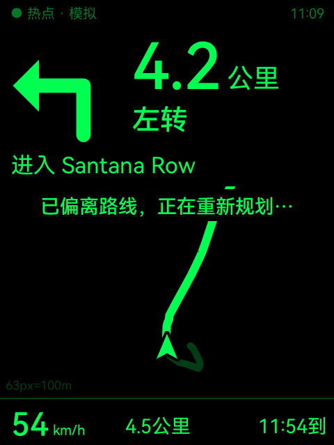
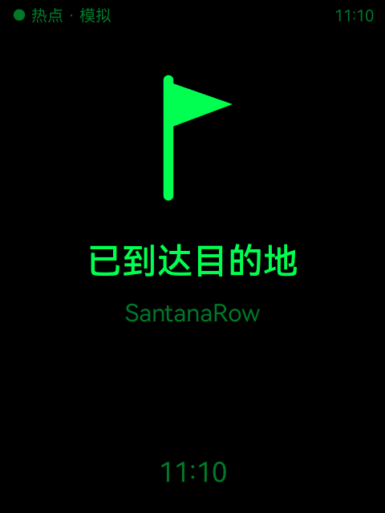
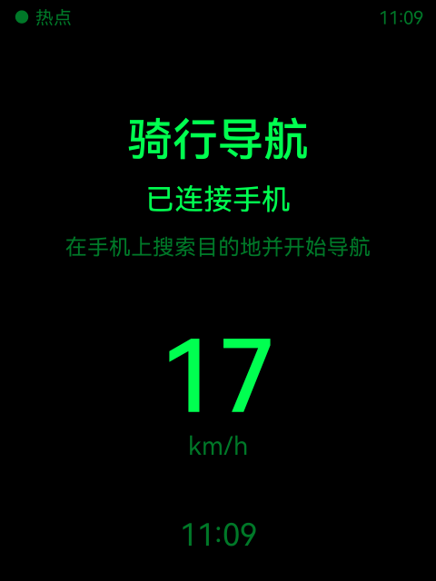
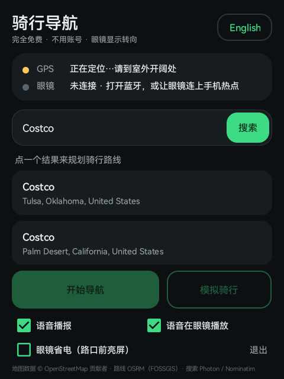
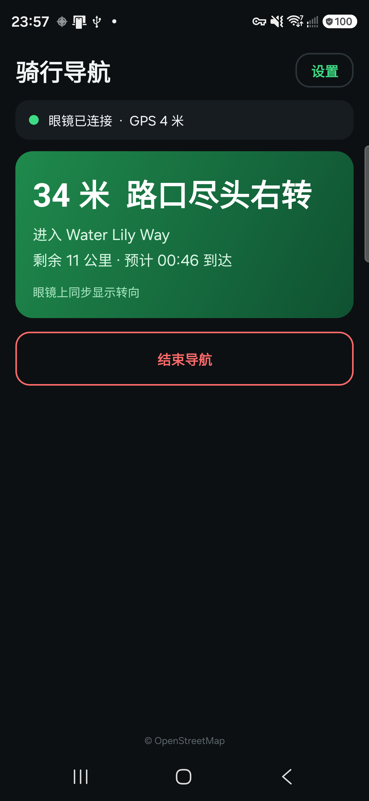
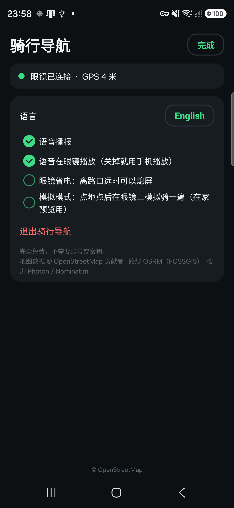

# 骑行导航 HUD 功能介绍

一句话介绍：**戴上乐奇（Rokid）眼镜骑车，眼前就有转向箭头和路线，耳边有中文语音提示，而且完全免费。**

本项目主要为海外用户设计。国内乐奇眼镜有高德导航，海外没有可用的方案，Google 地图又要付费的 API Key。所以这个项目改用 OpenStreetMap 的公益服务，不注册、不用密钥、不收费。

---

## 眼镜上能看到什么

| 转弯前 | 长直路 | 环岛 |
|:---:|:---:|:---:|
|  |  |  |
| 大箭头和距离，下一条路的路名，小地图上实心圆点是下一个路口 | 距离较远时，小地图自动缩小，能看到更远的路 | 显示从第几个出口出去 |

| 偏离路线 | 到达 | 连接上手机 |
|:---:|:---:|:---:|
|  |  |  |
| 骑错路时会提示，并自动重新规划 | 显示终点旗子，约 25 秒后自动结束 | 没有导航时显示车速和时间 |

画面各部分的含义：

- **左上角**：连接方式（热点或蓝牙）。处于模拟中或 GPS 信号弱时，也会显示在这里。
- **大箭头**：下一个动作。支持左转、右转、向左前方、向右前方、急转、掉头、环岛（带出口编号）、到达。
- **大数字**：离下一个路口还有多远。
- **小地图**：
  - 车头朝上，你的位置是三角形箭头。
  - 前方路线是亮线，骑过的路线是暗线。
  - 快到路口时自动放大，路口远时自动缩小。
  - 轻点眼镜触控板，可以手动放大或缩小。
- **底部**：当前车速、剩余距离、预计到达时间。

## 语音提示

- 中文播报，例如：
  - "前方 250 米，左转，进入 Santana Row"
  - "前方 50 米，左转"
- 两个路口挨得很近时，会提前连着说，例如"前方 50 米，左转，随后右转"，不会等来不及了才提醒。
- **语音按"听到时"的位置算**：定位本身有零点几秒延迟，合成语音再传到眼镜播放又要约 1 秒，以前说"前方 50 米"时其实只剩约 40 米。现在按车速提前说。用真实路线测试（每种车速和 GPS 误差都跑），说的距离和听到时的实际距离，中位偏差从晚 10 米变成约 1 米；播放再慢一倍也只晚约 5 米（以前晚约 16 米）。所有该说的转弯提示都还在。
- 骑错路时说"已偏离路线，正在重新规划"，同一次偏离只说一次，不会重复唠叨。
- **按行进方向认路**（1.9.1）：路线在同一条街上去了又回来、或者两段路挨得很近时，手机按你骑行的方向判断你在哪一段，不会把你显示到对面那段上。模拟测试（去程和回程相隔 6 米、GPS 误差 3–12 米）：位置差 30 米以上的次数从 12328 次降到 46 次，最大误差从 1.2 公里降到 45 米；普通路线、偏航、掉头、抄近路回到路线的结果和以前完全一样。
- **拐错马上发现**：该拐没拐、或者提前一条路拐了，手机按 GPS 的行进方向判断"正在离开路线"，大约 5 秒就提醒并重新规划（以前要约 9 秒，按 6 米/秒算早了约 25 米）。正常骑行不会误报（真实路线上 60 次模拟骑行，GPS 误差 3–12 米）。
- **语音在眼镜播放**（默认开启）：手机合成语音后传到眼镜，用眼镜扬声器播出。骑车时手机放在口袋里也听得见。眼镜没连上时，自动改用手机播放。
- 用手机播放时，会先压低正在播放的音乐，播完再恢复。

## 手机端

手机只负责两件事：**选地点**和**定位**。点一下地点就出发，眼镜自动同步显示，不用再点别的。

| 选地点 | 导航中 | 设置 |
|:---:|:---:|:---:|
|  |  |  |
| 点一下就出发；点 ☆ 收藏、点 ★ 删除 | 只显示下一个转弯和结束按钮 | 语言、语音、省电、模拟模式都在这里 |

- **搜索目的地**：
  - 输入地名、地址或店名。英文地名最容易搜到，例如 Costco、Santana Row。
  - 也可以直接输入"纬度,经度"。
  - 搜索结果按离你的距离从近到远排列。
- **常去地点**：点地点右边的 ☆ 就收藏，再点 ★ 就删除。收藏的地点一直排在列表最上面，最多 30 个。
  - 保存的是搜索结果的原始坐标，导航时直接用这个坐标，不会偏。
  - 同一栋楼里的不同店铺（门牌号相同、只差几米）分开收藏，不会混在一起。
- **最近去过的地方**：自动记住最近 10 个，排在常去地点下面，点一下就能重新规划路线。
- **骑行路线**：
  - 优先使用自行车路线。
  - 骑行服务暂时不可用时，依次改用步行路线、驾车路线。改用驾车路线时会醒目提醒，因为可能经过禁止自行车的道路。
- **模拟骑行**：在设置里打开“模拟模式”，再点地点，就会在眼镜上沿整条路线模拟骑一遍，在家就能预览。
- **继续上次导航**：骑到一半手机端被系统关掉时，重新打开会在列表第一行显示"↻ 继续上次导航"，点一下就从当前位置重新规划，接着骑。正常到达或手动结束后，这一行不会出现。
- **没网也能继续**：开始导航时会把路线存到手机里。点"继续上次导航"时如果没有网络，就直接用存下来的路线接着骑。骑错路后要等有网才能重新规划。
- **中文 / English**：
  - 手机界面、语音播报、眼镜画面都支持中文和英文。
  - 默认跟随手机系统语言，右上角按钮可以随时切换，导航途中切换也立即生效。
  - 眼镜跟随手机上选的语言。
- **往返和绕圈路线**：终点就在起点附近，或者路线经过同一个路口两次时，转弯顺序和"已到达"的判断都不会错乱。
- **通知栏和锁屏**：显示下一个转弯和剩余距离，锁屏也能看到。
- **眼镜省电**（默认关闭）：开启后，离下一个路口超过 400 米时眼镜可以熄屏，接近路口时自动亮屏。适合长途骑行。

## 连接方式

眼镜和手机支持下面几种连接方式，可以同时开着，哪个先连上就用哪个，断了会自动重连：

1. **手机热点**：手机开个人热点，眼镜连上这个热点。眼镜会自动发现手机。
2. **蓝牙**：手机开着蓝牙就行，**不需要配对**，也不需要额外设置。换一台手机也能直接连。

眼镜重启后，大约一分钟内会自动启动并重新连上手机，不用手动打开。

另外，眼镜屏幕上会显示一个网址。手机浏览器打开这个网址，就能下载手机端安装包。

## 稳定性

发布前做过以下测试：

- 在眼镜上用圣何塞的真实路线完整模拟骑行，验证了转向提示、语音、偏航重算、到达和自动结束。
- 用安卓的测试定位注入"真实 GPS"信号骑完整条路线（走的是真实 GPS 的处理流程）。信号带约 3 米随机误差，过程中偏离路线 120 米、GPS 中断 12 秒、手机端被强制关闭后点"继续上次导航"，最后骑到终点。
- GPS 信号里没有速度和方向时，会根据前后两次位置自己计算。
- 偏离路线后回到路线（用真实的 5.1 公里骑行路线测试，不靠重新规划，也就是没网的情况）：
  - 偏出 120 米再原路回来、抄近路 1.5 公里后才回到路线、在 50 米外的平行路骑 750 米再回来、掉头往回骑 500 米：都在回到路线后的第 1 个定位恢复正确位置。
  - 折返路线两段相距 50 米、中途横穿过去：1.8 版修复前一直判断错误，修复后第 1 个定位就恢复。
  - 有网时，偏离路线约 3 秒后自动重新规划，眼镜同步显示新路线（在真机上测过）。
- 在真实的手机（三星 S24+）和乐奇眼镜上实测：
  - 两台设备没有配对过，打开软件约 1 秒通过蓝牙连上。
  - 手机锁屏的状态下模拟骑完整条路线，语音从眼镜播出，眼镜显示到达。
  - 中途关掉眼镜端再打开，约 5 秒重新连上。
  - 眼镜重启后不做任何操作，约 70 秒自动连上。

### 位置有多实时、多准

用注入的 GPS 信号实测（时速 25 公里，每个定位带约 3 米随机误差，共 68 个定位）：

| 项目 | 结果 |
|---|---|
| 更新频率 | 每秒 1 次（中位数 1.00 秒） |
| 从定位到数据发出 | 不到 0.1 秒 |
| 发给眼镜的位置和真实位置的差距 | 中位数 3.4 米，最大 9.9 米（基本就是注入的 GPS 误差） |
| 沿路线的里程误差 | 中位数 2.0 米，最大 10 米 |
| 误差 300 米的坏定位 | 被挡住，没有显示到眼镜上 |
| 500 米外的跳点 | 被挡住，没有显示到眼镜上 |
| GPS 中断 5 秒 | 数据继续每秒发送，并标记"GPS 信号弱" |

为了位置准确做的处理：

- **起点必须是新位置**：只有 30 秒内、误差不超过 100 米的位置才能用来规划路线，不会用系统里存的旧位置。
- **导航中挡掉坏定位**：误差超过 80 米的定位、时速超过 125 公里的跳点都会跳过。
- **贴着路线显示**（和车载导航一样）：骑在路线上时，眼镜上的位置放在路线上，方向跟着道路走，不会在路线两边晃。偏离路线时显示原始 GPS 位置。
- **距离平滑**：按车速预测，再和新定位折中。往前骑时到路口的距离只减不增，等红灯时位置不乱跳。
  拐弯时机不受平滑影响：在真实路线的每个路口测试，显示"到达路口"时骑手真实位置的偏差中位数约 1 米，和平滑前一样。
  用真实的 5.1 公里路线测试（城市街道，GPS 误差约 8 米）：位置误差中位数从 9.6 米降到 4.9 米，骑行中距离倒退从 71 次降到 1 次，等红灯时每秒乱跳从 4.4 米降到 0.3 米。
- **眼镜画面每秒 10 帧**：两次定位之间，按当前速度和方向把位置往前推，下一次定位到了再校正，画面不会落后一截。

真实骑行时的精度取决于手机 GPS 本身，开阔路面一般 3–10 米，高楼之间会差一些。
- 眼镜端压力测试：
  - 乱码、超长数据、超大数值、2 万个点的路线、每秒 50 条数据。
  - 反复断线重连、手机突然没有响应。
  - 结果：不崩溃、不卡死，内存稳定。
- 手机端压力测试：
  - 20 MB 垃圾数据、同时 60 个连接，导航和语音都照常进行。
- 后台线程出意外会自动重启；画面绘制和数据接收互不阻塞。

## 已知限制

- **还没用真实 GPS 实际骑过**（手机和眼镜的连接已在真机上测过，定位是模拟的）。欢迎试用后在 Issues 里反馈。
- 免配对的蓝牙连接没有加密：附近同样运行本软件的设备理论上也能连上。
- 规划路线、搜索、偏航重算需要手机联网。导航途中的定位只靠 GPS，不需要网络。
- 英文语音用的是手机自带的英文语音引擎，手机上没装英文语音时会改用系统默认语音。
- 美国等海外地区的地点用英文搜索效果最好。
- 使用同一个公共 Wi-Fi 时，同一网络里的其他设备理论上可以连到手机端，读取导航数据（包括位置）。建议用**手机热点或蓝牙**连接眼镜，不要在公共 Wi-Fi 下使用。
- 眼镜扬声器的音量跟随眼镜的媒体音量。如果听不清，在眼镜上调大音量。

## 使用的免费服务

| 用途 | 服务 |
|---|---|
| 地图数据 | © OpenStreetMap 贡献者（ODbL） |
| 骑行路线 | FOSSGIS OSRM（routing.openstreetmap.de） |
| 地点搜索 | Photon（komoot），备用 Nominatim |

这些都是公益服务，请正常使用，不要大批量请求。
